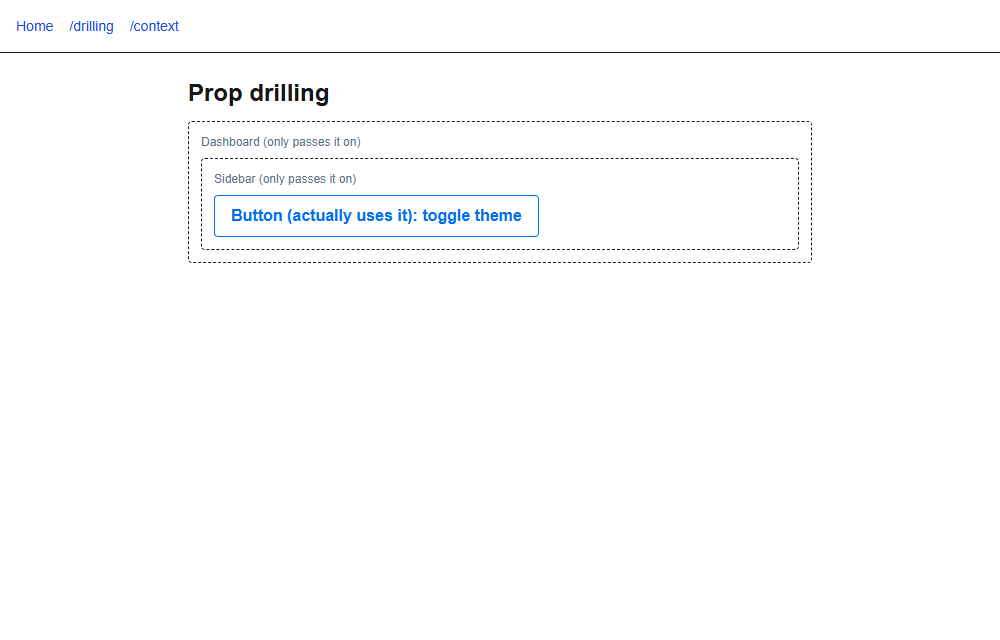
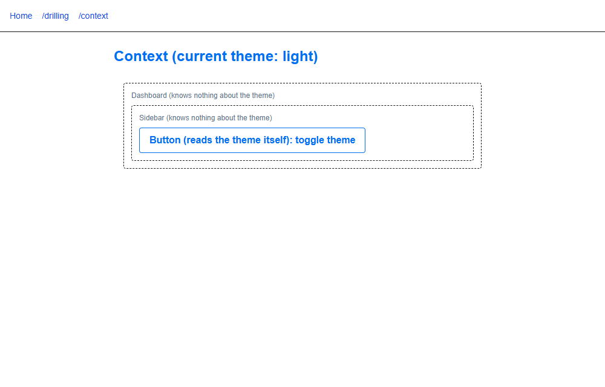
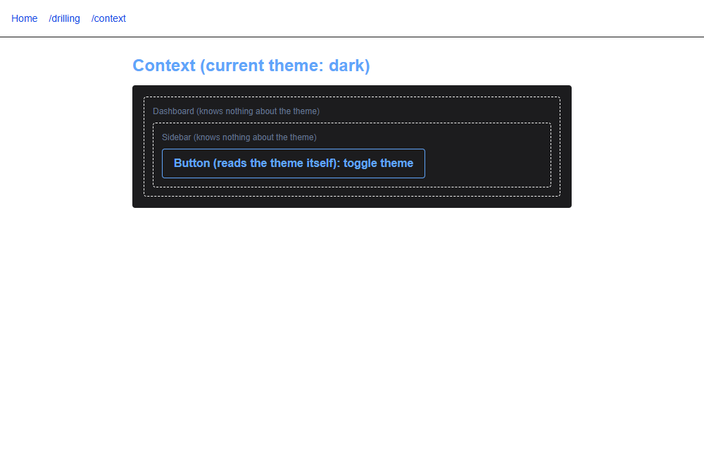

# 02. Theme Context

From the React Context slides (pages 007 to 010).

The same three levels of components built twice: once passing the theme down as
a prop, once with the slide's `ThemeProvider` and `useTheme()`.

## Run it

```bash
npm run build
```

```bash
npm start
```

```
http://localhost:3002
```

## Worth showing

**`/drilling` is the slide's problem.** Dashboard and Sidebar never use the
colors. They only carry them down to the button at the bottom. Open the file and
count how many times `colors` appears.



**`/context` is the solution.** Dashboard and Sidebar know nothing about the
theme. The button asks for it itself with `useTheme()`. Click it: the title and
the whole box change together, because they all read the same context.




**The layout is still a Server Component.** Open `app/layout.tsx`. Only
`ThemeProvider` has `"use client"`. The `/context` page is a Server Component
too. It is placed inside the provider as `children`, which does not turn it into
client code (the last line of slide 008).

## What is different from the slides

**Slide 010 does not work as written.** It calls `useTheme()` inside a page it
labels "(Server Component)". Running that exact code fails the build:

```
Error: Attempted to call useTheme() from the server but useTheme is on the client.
```

That is slide 008's own rule: Server Components cannot read Context. Here the
parts that read the theme are small Client Components in
`components/themed.tsx`, and the page stays a Server Component that just places
them.

**The slide's provider can never change.** It always passes `defaultTheme`, so
there is nothing for components to react to. This one keeps the theme in
`useState` and shares a `toggle()` with it.
