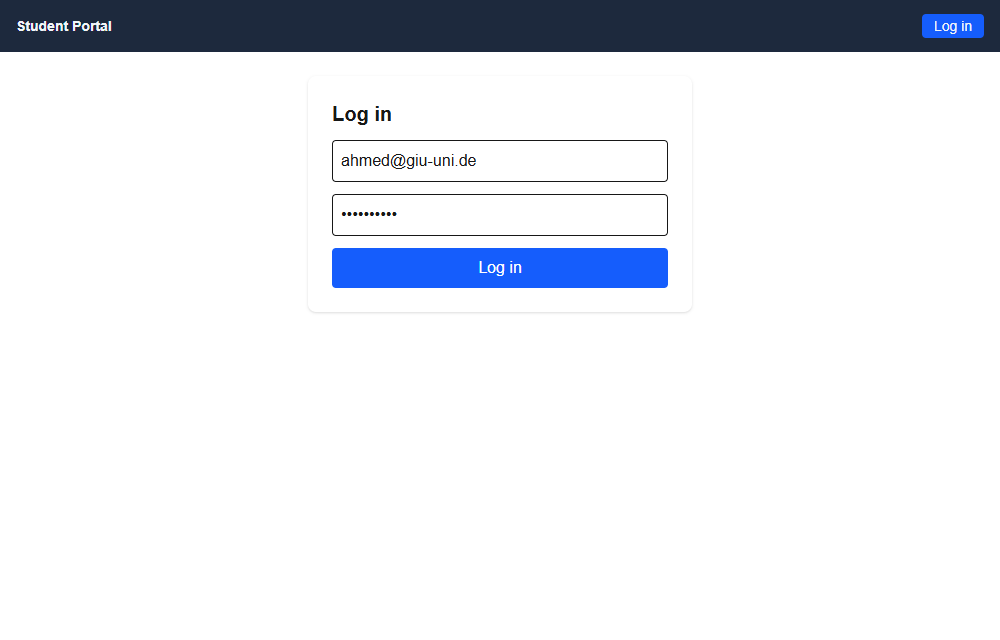
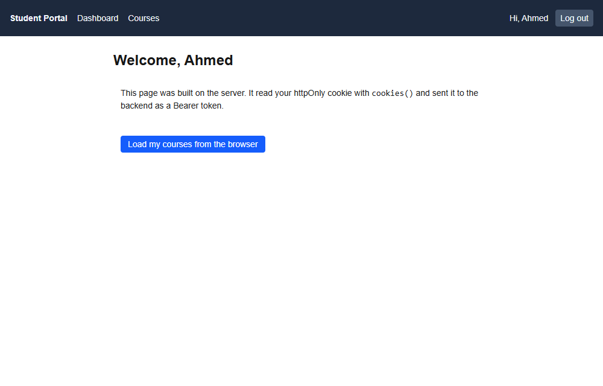
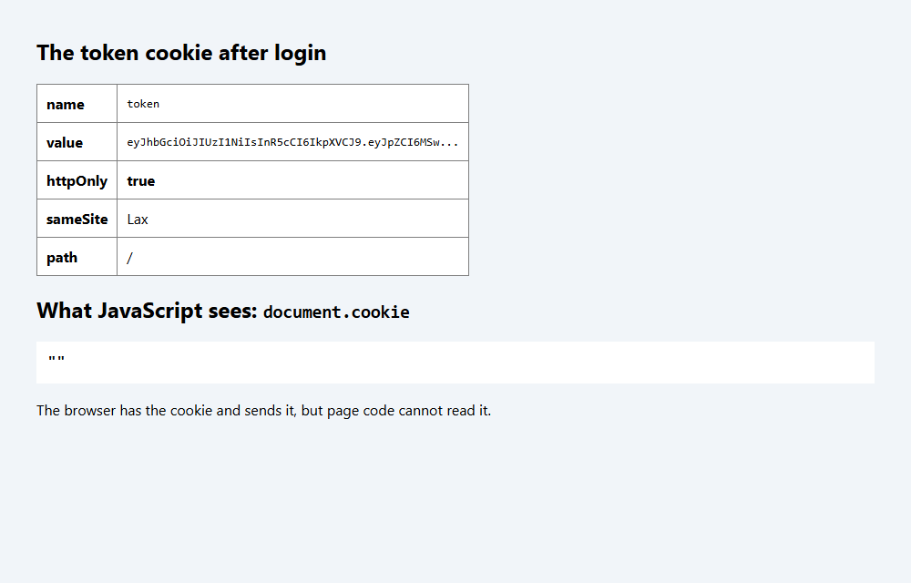
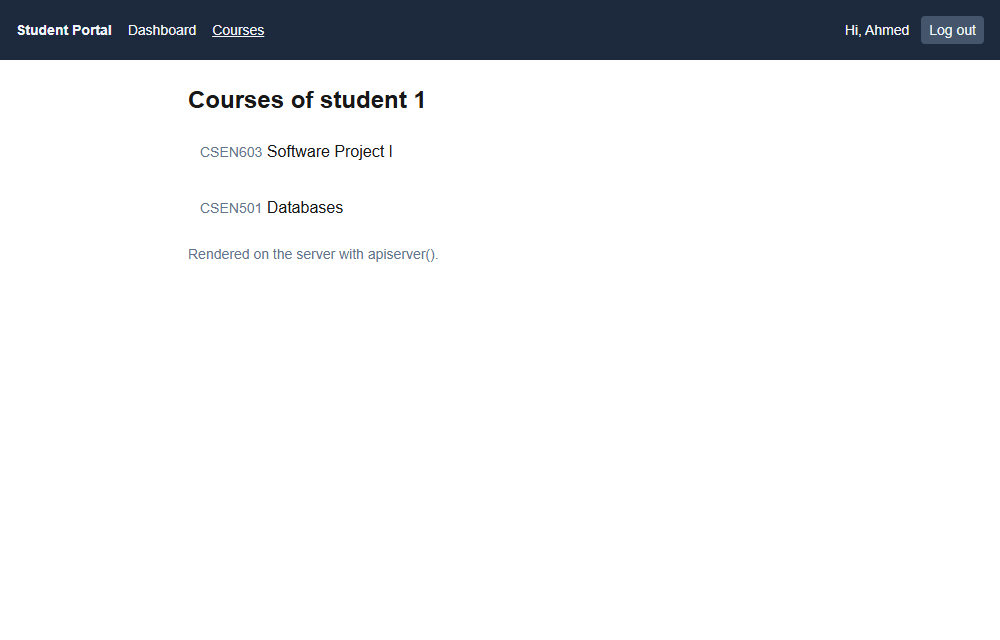
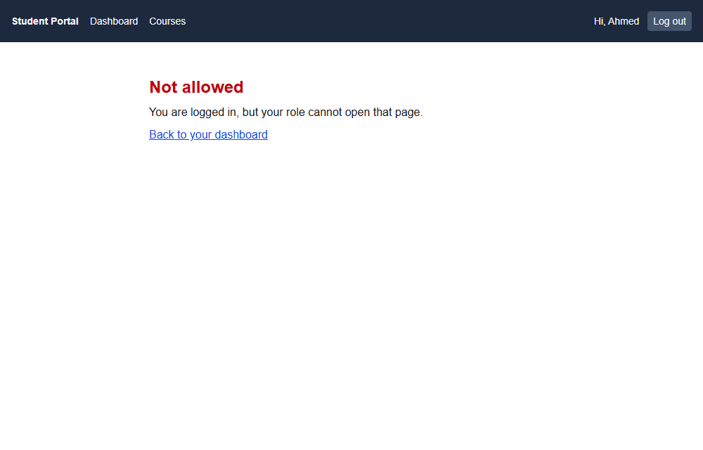
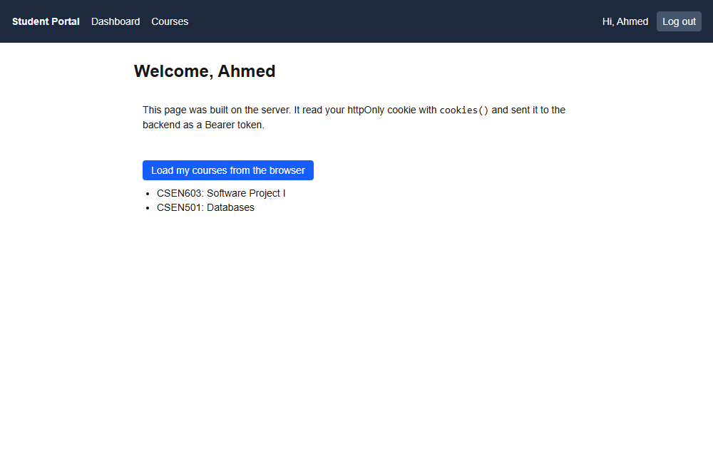
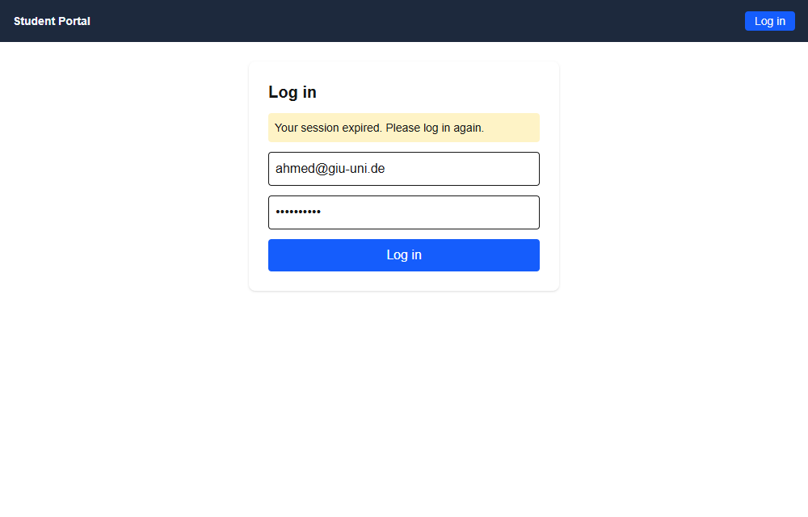
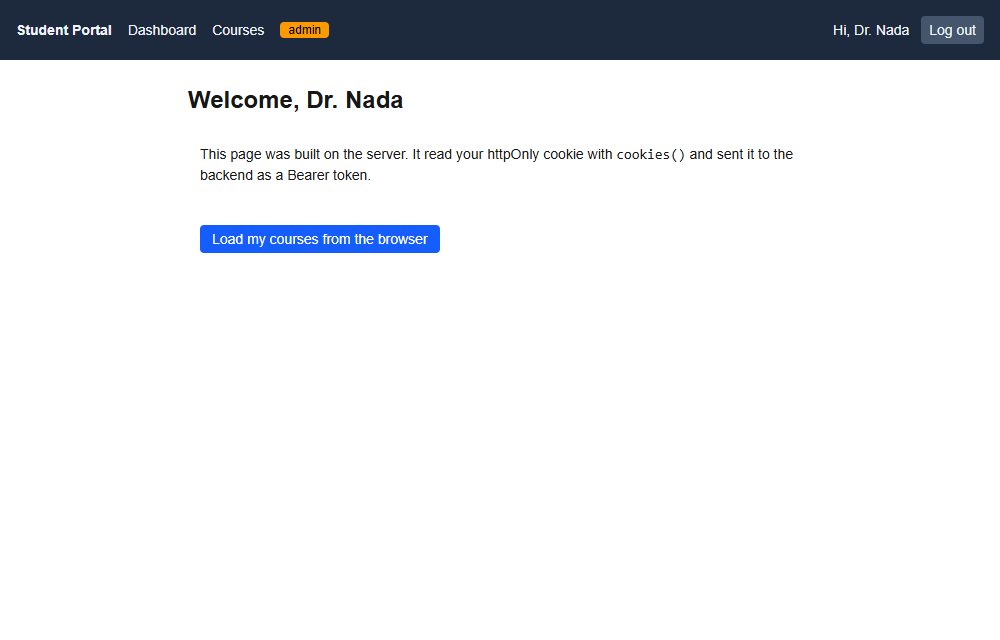
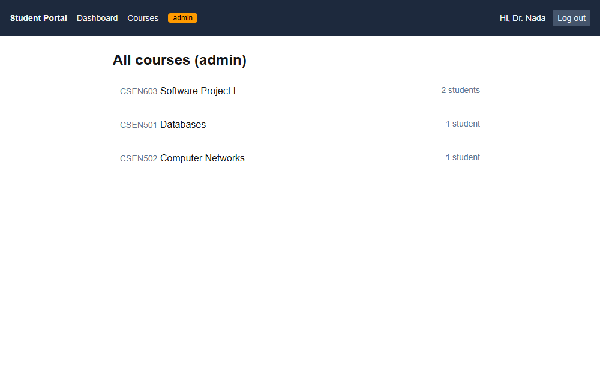

# 03. Student portal

The rest of the tutorial in one app: AuthContext (slides 011, 012), server side
authentication (013), authentication expiry (014), axios interceptors (015,
016), the client and server axios instances (017 to 020) and role based views
(021).

## Run it

The backend (folder 01) must be running first.

```bash
npm run build
```

```bash
npm start
```

```
http://localhost:3003
```

The accounts are on the home page.

## Where each slide lives

| Slide | File |
|---|---|
| AuthContext, fetching the current user | `lib/auth-context.tsx` |
| Provider in the layout | `app/layout.tsx` |
| Server side authentication | `app/dashboard/page.tsx` |
| Authentication expiry | `lib/auth-context.tsx` (on every navigation), `app/dashboard/check-again.tsx` |
| Axios interceptor | `lib/api-client.ts` |
| ApiClient (browser) | `lib/api-client.ts` |
| ApiServer (Server Components) | `lib/api-server.ts`, used in `app/students/[studentId]/courses/page.tsx` |
| Role based views | `app/components/navbar.tsx` |

## Worth showing

**Open `/dashboard` while logged out.** The server checks for the cookie before
rendering anything and redirects to `/login` (slide 013).



**Log in as Ahmed.** The navbar shows his name from `useAuth()`. The dashboard
itself was built on the server, which read the cookie with `cookies()`.



**The cookie is there, and JavaScript can't see it.** That is what `HttpOnly`
means:



**Click Courses.** It goes to `/students/1/courses`, a Server Component that
fetches with `apiserver()`: read the cookie, send it as a Bearer token.



**Now type `/courses`, the admin page.** The backend answers 403, the
interceptor catches it and sends him to `/unauthorized`. Typing
`/students/2/courses` ends there too, from the server side this time.



**Expiry, live.** Log in, click "Load my courses from the browser", wait one
minute, click again. The backend says 401, the interceptor calls AuthContext's
handler, the user is cleared and sent to `/login`.




**Log in as Dr. Nada.** Same navbar, same "Courses" link, different page: the
admin list. That's slide 021's one line:
`user.role == "student" ? "/students/1/courses" : "/courses"`.




## Why the server can read the cookie at all

The backend is on port 4000 and Next.js on 3003. Cookies belong to a host, not
a port, so the cookie set by `localhost:4000` is also sent to `localhost:3003`.
That is why `cookies()` finds it. In production the frontend and the backend
need to share a domain (for example `app.example.com` and `api.example.com` with
the cookie on `example.com`), or this stops working.

## What is different from the slides

Every point here was checked by running the slide's version.

**`redirect('/unauthorized')` inside the interceptor does nothing.** Slide 016
calls `redirect` from `next/navigation` there. It only works while React is
rendering, and the interceptor runs after a request finishes. With the slide's
code a student opening `/courses` stays on "Loading all courses..." forever,
with no error. Here 403 is handled like 401: AuthContext registers a handler
that calls `router.push`.

**403 does not mean "token is not there anymore".** That is 401. 403 means the
backend knows who you are and you are not allowed (slide 016 has them the other
way round for 403).

**The base URL can't be `http://localhost:3000`.** That is where Next.js itself
runs (slide 018 and 019). The backend needs its own port, 4000 here.

**Checking that a token exists is not checking that it is valid.** Slide 013
only does `if (!token)`. An expired token still exists. The dashboard here also
asks the backend with `/auth/me` and redirects if it says no.

**`user!.role` crashes when nobody is logged in.** Slide 021 uses the `!` to
silence TypeScript, but `user` really is `null` before login. The navbar here
only shows the link when `user` exists.

**The login page kept saying "Logging in...".** Found while taking the
screenshots: Next.js 16 keeps a page alive after you leave it, so coming back
to `/login` after an expiry showed a disabled button. The form now resets its
state whether login succeeds or fails.

**Reading the URL needs Suspense.** AuthContext uses `usePathname()` to
recheck on every navigation (slide 014). In Next.js 16 that has to sit inside
`<Suspense>`, which is why the layout wraps the provider in one.
