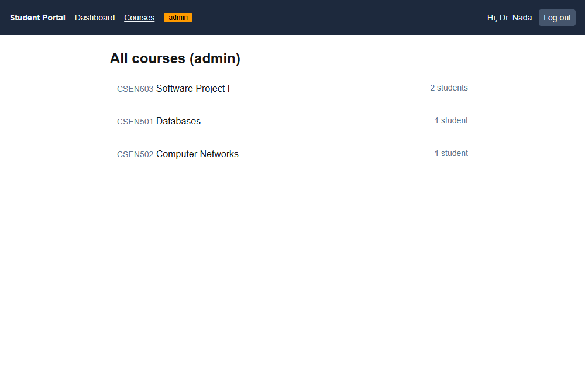

# Next.js in depth

Examples for Tutorial 8: authentication with httpOnly cookies, React Context,
AuthContext, server side auth, expiry, axios interceptors, the client and server
axios instances, and role based views.



## Install once

All three folders share one `node_modules` in this folder:

```bash
npm install
```

## The folders

| # | Folder | Slides | Port |
|---|---|---|---|
| 01 | `01-backend` | The problem, HTTP-only cookies, the login flow (004 to 006) | 4000 |
| 02 | `02-theme-context` | React Context, providers in Next.js, consuming context (007 to 010) | 3002 |
| 03 | `03-student-portal` | AuthContext, server side auth, expiry, interceptors, ApiClient and ApiServer, role based views (011 to 021) | 3003 |

Each folder has its own README with screenshots of what to show.

## Run everything

```bash
node run-all.js
```

Starts the backend, builds both frontends and starts them, all in one terminal,
with each line tagged by folder number. Ctrl+C stops everything. Then open
http://localhost:3003 and log in with an account from the home page.

Or one folder at a time: `npm start` in `01-backend`, then `npm run build` and
`npm start` in the other two.

## The screenshots

Every picture in the READMEs was taken by `screenshots.mjs`, which drives a real
Chrome through every scenario: logged out, student, admin, a 403, and a token
that expires. It doubles as the end to end test. To retake them, start the
backend with short tokens, start both frontends, then:

```bash
node screenshots.mjs
```

On Windows PowerShell, start the backend with
`$env:TOKEN_SECONDS=8; npm start` inside `01-backend`.

## Things the examples caught

Each one was found by running the slide's code. Details are in the folder
READMEs.

- Slide 010 calls `useTheme()` in a page it labels a Server Component. The build
  fails: "Attempted to call useTheme() from the server". Folder 02.
- Slide 016 calls `redirect('/unauthorized')` inside the axios interceptor. It
  silently does nothing, and the page hangs on its loading message. Folder 03.
- Slide 016 says 403 means the token is gone. That is 401. 403 means "logged in,
  not allowed". Folder 03.
- Slides 018 and 019 point axios at `http://localhost:3000`, which is Next.js
  itself. The backend needs its own port. Folder 03.
- Slide 013 only checks that a token exists, so an expired token gets in. The
  dashboard here also asks the backend. Folder 03.
- Slide 021's `user!.role` crashes when nobody is logged in. Folder 03.

## Suggested order for a live session

1. **01** `npm run demo`: read the Set-Cookie header against slide 005's table.
2. **02** prop drilling, then the same page with Context.
3. **03** log in as Ahmed, follow the slides file by file.
4. **03** the 403, then the one minute expiry.
5. **03** log in as Dr. Nada: same navbar, different links.

Short on time? Folder **03** alone covers most of the slides.
